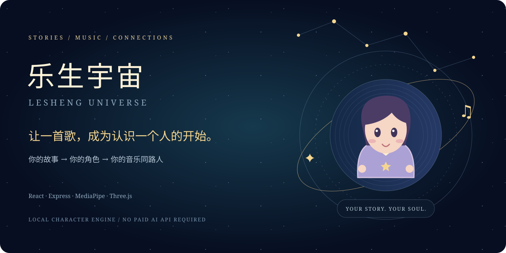
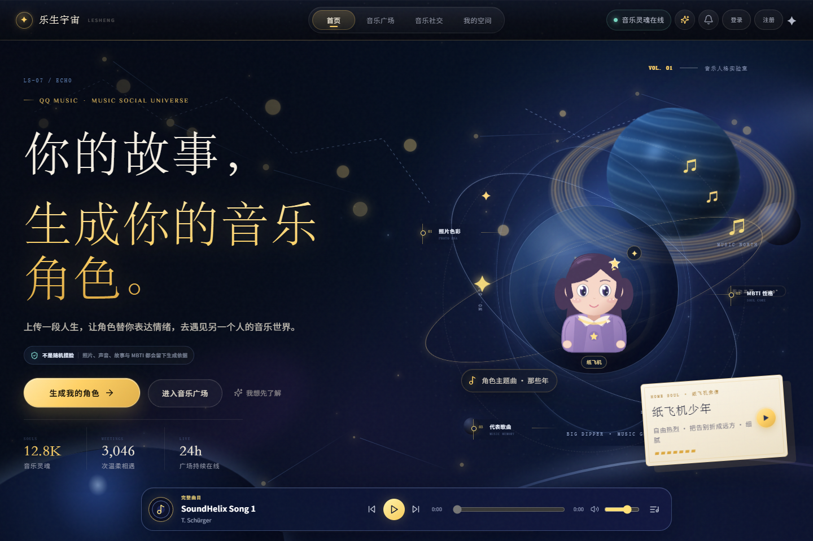
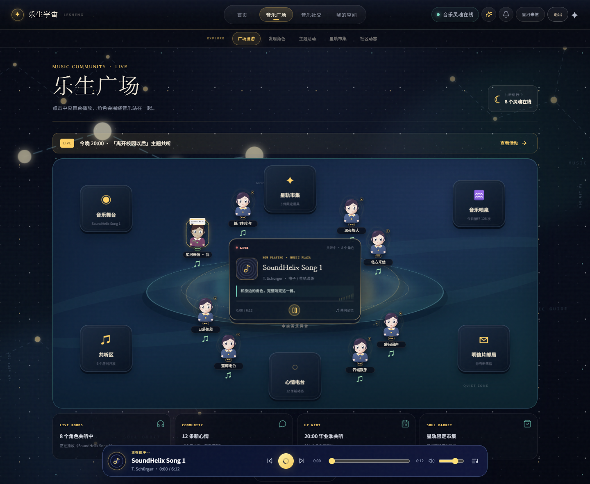
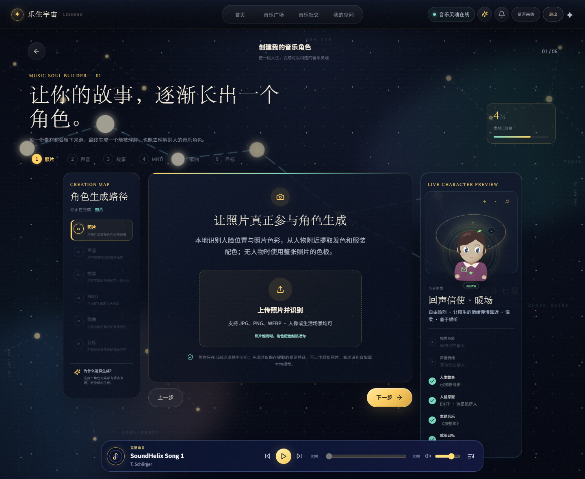
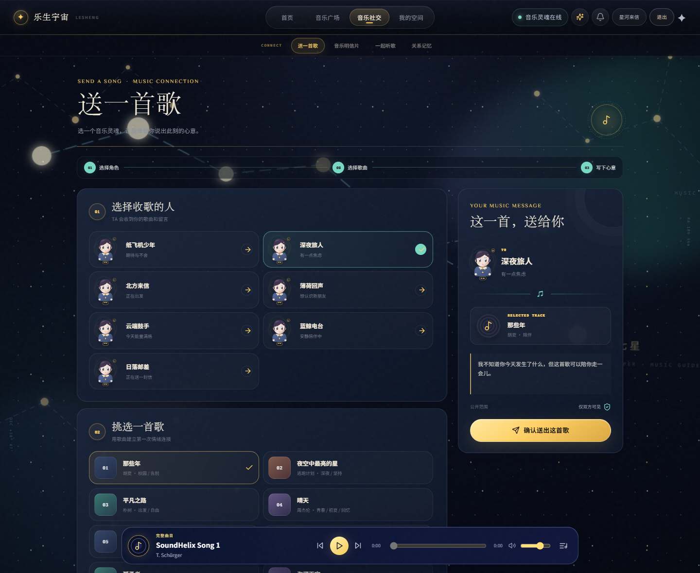

<p align="center">
  
</p>

<h1 align="center">乐生宇宙 · Lesheng Universe</h1>

<p align="center"><strong>让一首歌，成为认识一个人的开始。</strong><br/>Turn your story into a character. Turn a song into a connection.</p>

<p align="center">
  <a href="https://github.com/1828703450qqcom-ux/lesheng-universe/actions/workflows/ci.yml"></a>
  <a href="LICENSE"></a>
  
  
  
</p>

<p align="center"><a href="#一分钟了解">为什么做</a> · <a href="#看看它的样子">界面预览</a> · <a href="#快速开始">本地运行</a> · <a href="docs/architecture.md">架构</a> · <a href="docs/roadmap.md">路线图</a> · <a href="README.en.md">English</a></p>

> 有些话，不好意思直接说。那就让你的角色，送出一首懂你的歌。

## 一分钟了解

音乐产品擅长回答“我想听什么”，但还有一种需求：**我想被理解，却不知道怎样开口。**

乐生宇宙把照片、声音、故事、MBTI、代表歌曲和人生目标，转化为一个带有生成依据的 **2D 音乐角色**。角色来到星空广场，用送歌、音乐明信片和共听记忆，开启一次轻一点的社交。

不是先发一句“在吗”，而是先交换一首歌。

**故事素材 → 可解释的角色 → 广场相遇 → 音乐互动 → 关系记忆**

这是一个可在本地运行的全栈黑客松原型，不是 QQ 音乐官方产品；没有官方合作背书，也不包含商业曲库授权。

## 看看它的样子

以下截图来自本地启动后的真实界面，使用项目种子角色与专门创建的虚构演示账号，不包含线上用户资料。首页与活动页的数量、时间等展示值为原型示例，不代表真实运营数据。

### 把故事放进星空



### 在同一首歌旁边相遇



### 不止看见一个头像，也看见它的来处



### 用音乐把心意送出去



## 值得打开的六个瞬间

- **一张照片，变成角色的灵感。** MediaPipe 在浏览器本地定位人脸，结合色板、用户故事与目标生成 SVG 角色；发色、服装、道具和人格标签都有可追溯的线索。
- **不是固定的三个头像。** 稳定种子、加权特征、角色原型和外观令牌共同决定角色。相同输入可复现，不同故事可以产生不同组合。
- **一起站在音乐旁边。** 广场有中央播放屏幕、角色互动卡片、社区心情气泡，以及活动、市集、共听和明信片入口。
- **把关心做成一首歌。** 选择收件角色，附上歌曲、情绪和留言；也可以制作带场景的音乐明信片。
- **一首歌真的可以听完。** 使用原生 Audio 播放完整示例曲目，支持进度、上一首/下一首、循环、播放列表、跨页面播放与本地音频导入。
- **让关系留下记忆。** 送歌、明信片和共听记录进入关系页；有账号、角色空间、通知、社区动态与演示市集。

### 关于“AI 生成”，说清楚一点

默认角色引擎是**本地视觉分析 + 规则与加权组合 + SVG 绘制**，不需要付费大模型或图像生成 API Key。它不是扩散模型，不是照片身份复刻，也不会从照片科学判断人格。MBTI 来自用户填写；声音仅提取时长、能量和节奏等信号，不进行声音克隆或完整语音转写。

照片原图不会由当前应用上传至后端；保存的是角色及相关派生特征。完整生成机制见 [架构说明](docs/architecture.md) 和 [本地照片识别](docs/local-photo-vision.md)。

## 快速开始

需要 **Node.js 22.12+（建议 24 LTS）**、npm 和 Git。默认角色与音乐演示不需要外部 API Key；首次安装依赖需要联网，页面字体使用在线字体并带系统字体回退。

第一次运行代码？先安装 [Node.js](https://nodejs.org/en/download)（包含 npm）和 [Git](https://git-scm.com/downloads)，再打开 PowerShell / Terminal 粘贴下面的命令。看到开发服务器地址后保持该终端运行，在浏览器打开地址；按 `Ctrl+C` 可停止服务。

```bash
git clone https://github.com/1828703450qqcom-ux/lesheng-universe.git
cd lesheng-universe
npm run install:all
npm run dev
```

- 前端：<http://localhost:5173>
- 后端健康检查：<http://localhost:4000/api/health>
- 本地数据：`server/data/lesheng.json`，首次启动自动创建，不随仓库分发。

**第一次体验：** 先逛广场听一首歌 → 注册本地账号 → 完成角色创建 → 选择一个角色送歌。注册只用于此原型的本地账号系统，没有真实邮件验证；请勿使用真实密码、敏感照片或私人日记。

浏览器录音需要 localhost 或 HTTPS 与用户授权；手机局域网 IP 的普通 HTTP 环境可能无法使用麦克风，可改为上传音频。手机访问时前端可运行 `npm run dev --prefix client -- --host 0.0.0.0`，同时保证后端 4000 端口可访问。

### 测试与构建

```bash
npm test
npm run build
npm run test:smoke
npm run check:publication
```

`npm test` 覆盖角色引擎与音乐播放单元测试；`test:smoke` 在临时目录创建干净数据并启动隔离后端，不会改动你的本地账号库。正式部署还需要配置前端静态服务、API/WebSocket 反向代理与 HTTPS，参见 [部署说明](docs/deployment.md)。

## 音乐，认真播放；版权，也认真对待

仓库附带 **SoundHelix Song 1 / 2 — T. Schürger** 的完整示例录音与署名。它们不是角色目录里《那些年》《晴天》等中文歌曲的原曲。

- 自有或已授权完整音频：使用播放器导入本地文件，或通过已有上传接口配置歌曲音源。
- 已授权音乐服务：服务端设置 `MUSIC_PROVIDER_URL`，可选 `MUSIC_PROVIDER_TOKEN`；详见 [音源适配文档](docs/deployment.md#授权音源适配)。
- 没有音源的目录歌曲：明确显示不可播放，不拼接试听、不合成替代歌曲、不绕过付费或版权限制。

请保留 [第三方署名与许可](THIRD_PARTY_NOTICES.md) 及 [音乐署名](client/public/music/ATTRIBUTION.md)。

## 给想研究代码的你

```text
client/src/character/    本地角色引擎、视觉分析、SVG 绘制与测试
client/src/music/        单例播放器、曲库、播放列表与测试
client/src/Planet3D.jsx  Three.js 网格星球、着色器与交互
client/src/main.jsx      页面、路由与音乐社交体验
server/src/index.js     认证、角色、社区、关系、WebSocket 与持久化
server/src/musicPlayback.js  完整音源解析与授权服务适配
docs/                   架构、部署、路线图与演示路径
```

当前数据层是 **JSON 文件持久化**，不是 SQLite/PostgreSQL。适合本地体验与小规模演示，不适合高并发生产服务。服务器需要 Node.js，不能仅把前端放上 GitHub Pages 就拥有账号和社交后端。

## 一起把它做得更好

特别欢迎这几个方向的贡献：**更可爱的角色风格、移动端首屏与无障碍、双端共听同步、数据库适配、授权音源适配**。

1. 在 [Issues](https://github.com/1828703450qqcom-ux/lesheng-universe/issues) 描述场景或问题。
2. 阅读 [贡献指南](CONTRIBUTING.md)，跑通测试，再提交小而清晰的 PR。
3. 使用虚构素材复现问题，不要公开用户照片、令牌或私人故事。

已经实现的原型、待打磨的体验与尚未实现的愿景分开列在 [路线图](docs/roadmap.md)。跨设备低延迟共听、官方 QQ 音乐授权、AI 作曲、声音克隆、艺人权益与真实支付**不是已完成能力**。已知移动端新手引导、首屏信息优先级和部分音频引擎兼容性仍需改进。

## 许可

项目原创代码采用 [MIT](LICENSE)。第三方模型、运行时、示例音频及品牌标识不因本项目采用 MIT 而改变其原有许可或权利。

<p align="center"><strong>不必急着说你好。先分享一首，此刻最像你的歌。</strong></p>
